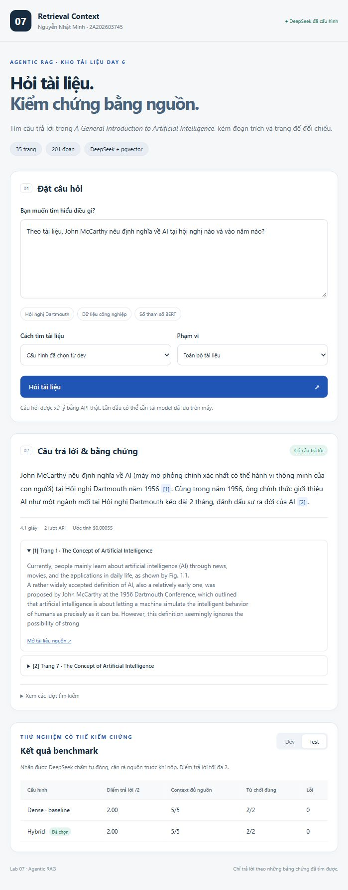

# Chạy web hỏi tài liệu

## Mở nhanh trên máy hiện tại

1. Mở Docker Desktop. Nếu database đang dừng, chạy PowerShell:

   ```powershell
   docker start day6_student_starter-postgres-1
   ```

2. Trong repo Day 7, bấm đúp `CHAY_WEB.cmd`, giữ cửa sổ terminal mở.
3. Mở trình duyệt tại <http://127.0.0.1:8767>.
4. Chọn câu mẫu hoặc nhập câu hỏi, chọn cách tìm/phạm vi, bấm **Hỏi tài liệu**.
5. Bấm nguồn dưới đáp án để đọc chunk và trang. **Xem các lượt tìm kiếm** cho
   biết query đã viết lại. Tab Dev/Test chỉ đọc kết quả đã lưu.

Lần hỏi đầu cần nạp embedding local, có thể mất khoảng 1–3 phút. Những lần sau
dùng lại model. Mỗi lần hỏi gọi DeepSeek thật và có phí theo usage; key nằm
trong `.env` ở backend. Dừng bằng `Ctrl+C` tại terminal rồi đóng cửa sổ.

Không dán các dòng dấu ``` vào PowerShell; chỉ chép lệnh bên trong khung.

## Lệnh tương đương

Chạy tại gốc repo Day 7:

```powershell
$labPython = "$env:USERPROFILE\.venvs\day06-dataingestion\Scripts\python.exe"
& $labPython -B -X utf8 scripts/serve_web.py --day6 "..\K5-L3B-DAY06-NguyenNhatMinh-2A202603745-DataIngestion"
```

Nếu đổi vị trí Python/Day 6, sửa đường dẫn trong lệnh hoặc `CHAY_WEB.cmd`.
Máy mới cần cài [requirements.txt](../requirements.txt), chuẩn bị dữ liệu theo
[hướng dẫn](CHUAN_BI_DU_LIEU.md) và cấu hình [DeepSeek](CHAY_AGENT.md).

## Ba câu kiểm tra trên dev

| Câu hỏi | Kết quả cần kiểm tra |
|---|---|
| Theo tài liệu, John McCarthy nêu định nghĩa về AI tại hội nghị nào và vào năm nào? | Dartmouth, 1956; citation trang 1 hoặc 7. |
| Trong phần Công nghệ liên quan đến AI, đặc điểm Industrial data của Huawei CLOUD EI giúp doanh nghiệp khai thác dữ liệu riêng để làm gì? | Nguồn trang 23: tạo giá trị qua xử lý và khai phá dữ liệu. Cấu hình hiện tại còn từ chối nhầm; đây là ví dụ lỗi dev đã ghi nhận. |
| Theo chương tài liệu, mô hình BERT có chính xác bao nhiêu tham số? | Tìm rồi báo không đủ bằng chứng; không tự đưa số từ kiến thức ngoài. |

Câu mẫu không cung cấp đáp án/gold cho agent. Không dùng test để tiếp tục
điều chỉnh cấu hình đã chốt. Trace hỏi thủ công lưu ở `results/web/`, tách khỏi
benchmark chính thức. Điểm hiển thị do API chấm; xem thêm bản rà citation trong
[báo cáo](../report/individual/2A202603745_NguyenNhatMinh.md).



Web chỉ lắng nghe `127.0.0.1`, không được triển khai công khai. Chỉ phục vụ ba
file giao diện và API cho phép; URL `.env`, `.git` và đường dẫn ngoài web trả 404.
